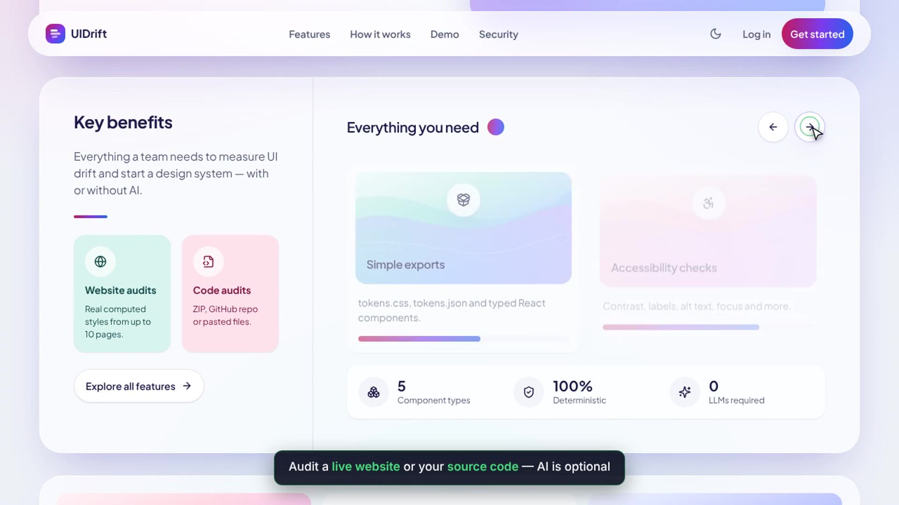
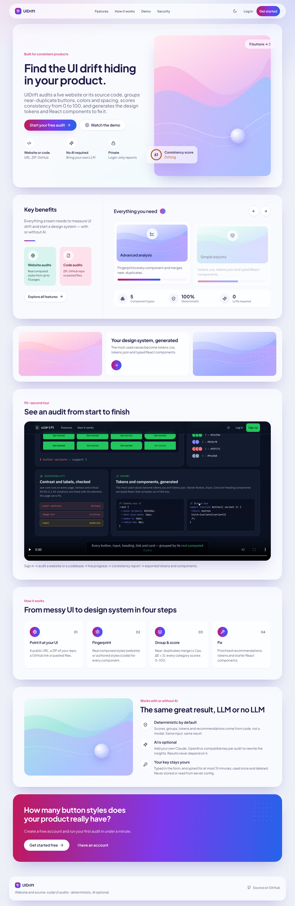
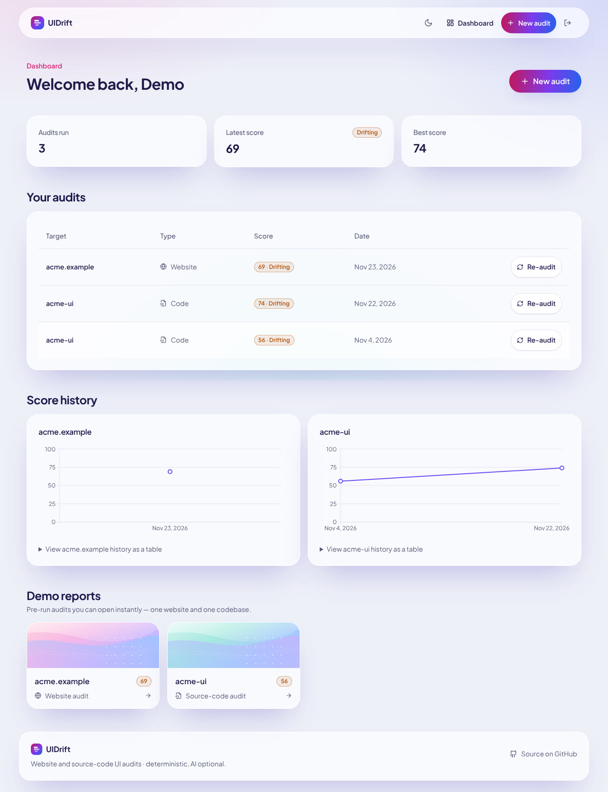
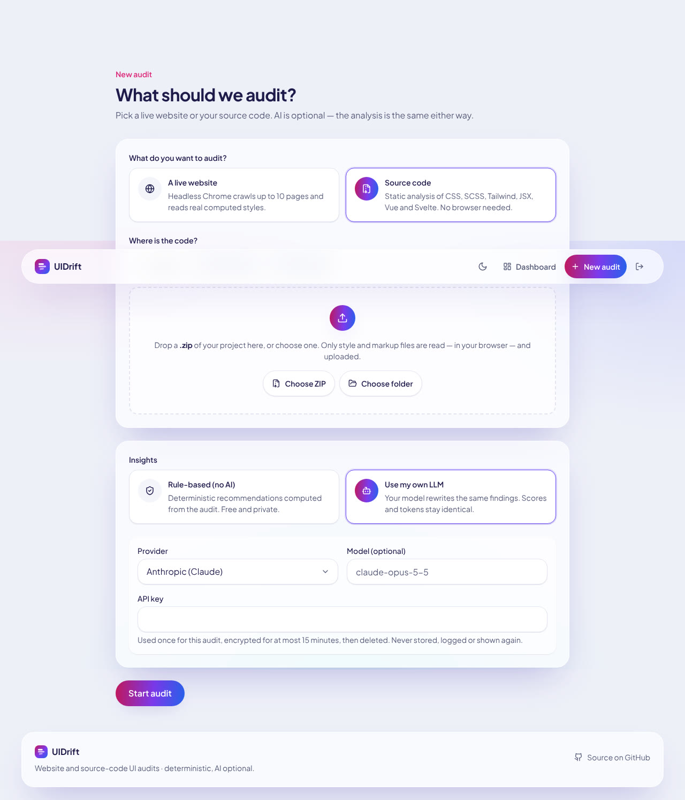
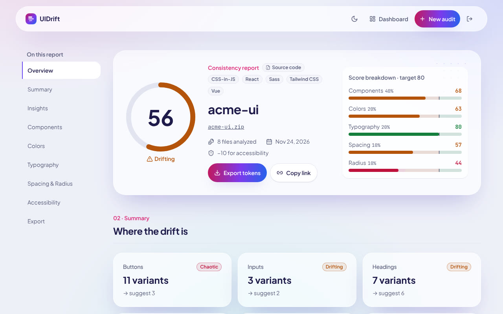
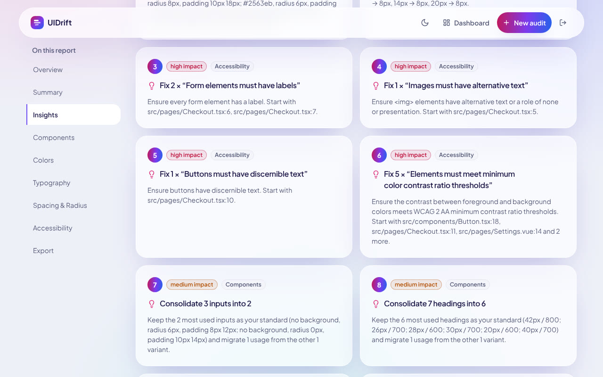
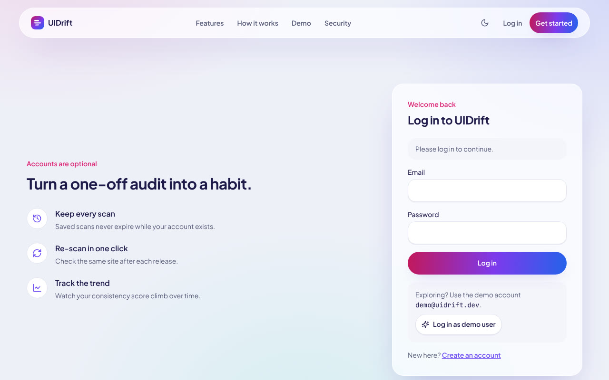
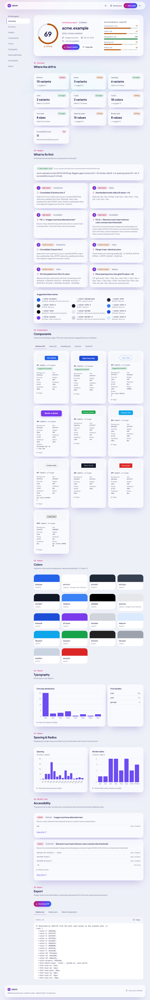
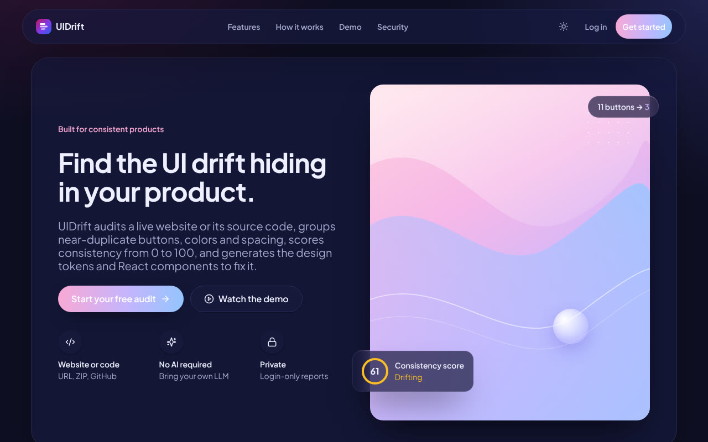

# UIDrift

**Find the UI drift hiding in your product.**

UIDrift audits a **live website** or its **source code**, pulls out every button, input, heading, link and card with its styles, groups the near-duplicates and gives the product a **0–100 UI consistency score**. It then generates **design tokens**, **starter React components** and a **prioritized fix list** from the most common patterns.

Everything is computed by deterministic code. **No LLM is required.** You can optionally plug in your own Claude, OpenAI or OpenAI-compatible key per audit to have the insights rewritten. Scores, groups and tokens are identical either way.

[](docs/demo/uidrift-demo.mp4)

▶ **[Watch the 2-minute demo](docs/demo/uidrift-demo.mp4)**: landing → login → source-code audit (ZIP) → insights → bring-your-own-LLM → website audit → dark mode.

---

## Contents

- [Quick start](#quick-start) · [Demo users](#demo-users) · [Features](#features) · [How it works](#how-it-works)
- [AI is optional](#ai-is-optional-same-result-with-or-without-an-llm) · [CLI](#command-line-no-ui-no-llm) · [Screenshots](#screenshots)
- [Tech stack](#tech-stack) · [API](#api) · [Security](#security) · [Deployment](#deployment) · [Docs](#documentation)

## Quick start

Requires **Node.js 20+**, plus Docker for MongoDB and Redis (or your own instances).

```bash
git clone https://github.com/mrahuls2608/UiDrift.git && cd UiDrift

./scripts/run-demo.sh local     # Mongo + Redis in Docker, installs, seeds demo users, starts API + app
# or
./scripts/run-demo.sh docker    # everything in Docker (production build), seeded
```

Open **http://localhost:3000** and click **Log in as demo user**.

| Command                                                      | What it does                                                                                                                                                                                                            |
| ------------------------------------------------------------ | ----------------------------------------------------------------------------------------------------------------------------------------------------------------------------------------------------------------------- |
| `./scripts/run-demo.sh local`                                | Starts MongoDB and Redis in Docker, unless `MONGODB_URI`/`REDIS_URL` are set. Writes `server/.env` and `web/.env.local` with a random `JWT_SECRET`, installs, seeds, then runs the API (`:4000`) and the app (`:3000`). |
| `./scripts/run-demo.sh docker`                               | `docker compose up --build` + `docker compose run --rm seed`                                                                                                                                                            |
| `./scripts/run-demo.sh seed`                                 | Re-creates the demo users and reports in the configured database                                                                                                                                                        |
| `MONGODB_URI=… JWT_SECRET=… ./scripts/run-demo.sh seed-prod` | Seeds a **production** demo database (`--force`)                                                                                                                                                                        |
| `./scripts/run-demo.sh stop`                                 | Stops the Docker services                                                                                                                                                                                               |

Manual setup instead:

```bash
npm install                                   # all workspaces; builds @uidrift/shared
cp server/.env.example server/.env            # MONGODB_URI, REDIS_URL, JWT_SECRET
cp web/.env.example web/.env.local            # API_URL=http://localhost:4000
npm run seed                                  # demo users + reports
npm run dev:api                               # :4000 (runs the audit worker inline)
npm run dev:web                               # :3000
```

## Demo users

Created by `npm run seed`. Every report comes from real analysis output: a recorded crawl of a test website, and the bundled [`samples/acme-ui`](samples/acme-ui) project analyzed live.

| Email                  | Password         | What they see                                                                      |
| ---------------------- | ---------------- | ---------------------------------------------------------------------------------- |
| `demo@uidrift.dev`     | `Demo@12345`     | Website and code audits, plus a real score trend (acme-ui 56 → 74 after a cleanup) |
| `designer@uidrift.dev` | `Designer@12345` | One source-code audit                                                              |
| `manager@uidrift.dev`  | `Manager@12345`  | One website audit                                                                  |

All signed-in users also see two **demo reports**. Use `npm run seed -- --password 'Your-Pass'` to set one password for all demo users (for a public demo). The seed refuses to run with `NODE_ENV=production` unless you pass `--force`, and it only replaces demo users and demo reports.

## Features

- 🔐 **Login-only.** The landing page is public; audits, progress, reports, exports and history require an account. This is enforced by the API (JWT cookie) and by a Next.js proxy that redirects to `/login?next=…`.
- 🌐 **Website audits.** Headless Chrome (Puppeteer) crawls up to 10 same-site pages, respects `robots.txt` and reads real computed styles. Accessibility is checked with axe-core.
- 🧾 **Source-code audits.** Static analysis with no browser and no network:
  - **Styles it reads:** CSS, SCSS/Sass (variables, nesting), LESS, CSS custom properties, Tailwind classes (full v3 palette, arbitrary values), styled-components/emotion, React inline styles, and Vue/Svelte/HTML `<style>` blocks.
  - **Input options:** upload a ZIP or a folder (read in the browser; only style and markup files are sent), a public GitHub repo, or pasted files.
- 🧩 **Grouping.** Near-duplicates merge (≤ 2 px, CIEDE2000 ΔE < 3), even across techniques: a Tailwind `bg-sky-500` button and a Vue `.save-button { background: #0ea5e9 }` are recognised as the same variant.
- 📊 **Score.** 0–100 per category and overall (PRD §9), minus up to 10 points for accessibility issues.
- ♿ **Accessibility.** axe-core for websites. For code, static checks with the same rule ids: `image-alt`, `label`, `button-name`, `link-name`, `tabindex`, `html-has-lang`, `color-contrast` (with the exact ratio) and removed focus outlines. Every finding has a `file:line`.
- 💡 **Insights.** Prioritized, data-backed recommendations ("Consolidate 11 buttons into 3", "#2464ea → #2563eb", "Snap 13px → 14px") and semantic token names. Rule-based by default; optionally rewritten by your LLM.
- 🎨 **Exports.** `tokens.css`, `tokens.json`, typed React `Button`/`Input`/`Card`/`Heading` (a test compiles them with strict TypeScript), or everything as a ZIP.
- 📈 **History.** Re-audit websites and GitHub repos in one click and track the score over time.
- ⌨️ **CLI.** `npm run analyze -- ./project` gives the same audit offline.
- 🌗 Soft-glass light theme (dark optional), keyboard navigation, reduced motion, WCAG 2.1 AA.

## How it works

```
Website:  URL ─▶ SSRF guard ─▶ BullMQ job ─▶ Puppeteer crawl + axe ─▶ computed styles ─┐
Code:     ZIP/folder/paste/GitHub ─▶ filter ─▶ CSS/SCSS/Tailwind/JSX/Vue parsers ─────┤
                                                                                       ▼
          fingerprint ─▶ group near-duplicates ─▶ cluster colors ─▶ score ─▶ tokens + React components
                                                                                       ▼
          rule-based insights ──(optional: user's LLM rewrites them)──▶ report (MongoDB, cached in Redis)
          progress ─▶ Redis pub/sub ─▶ Server-Sent Events ─▶ browser
```

Source audits are converted into the **same computed-style shape** a browser produces. Code and website audits therefore share one fingerprinting, grouping, scoring and generation pipeline.

## AI is optional (same result with or without an LLM)

|                                                 | No LLM (default)                | With your LLM                                                                                      |
| ----------------------------------------------- | ------------------------------- | -------------------------------------------------------------------------------------------------- |
| Crawl / parse, groups, colors, distributions    | ✅ deterministic                | ✅ identical                                                                                       |
| Score, tokens, React components                 | ✅ deterministic                | ✅ identical                                                                                       |
| Recommendations, summary, token names           | Computed by rules from the data | The model rewrites the rule-based findings (it receives the computed data, never your source code) |
| If the LLM fails (bad key, refusal, rate limit) | —                               | Falls back to the rule-based insights and shows why. The audit never fails.                        |

- **Providers:**
  - Anthropic, via the official SDK. The default model is `claude-opus-5-5`, with structured output and server-side refusal fallbacks.
  - OpenAI, using strict JSON-schema output.
  - Any OpenAI-compatible endpoint (Groq, Together, OpenRouter, a self-hosted model…), via `{baseUrl}/chat/completions`.
- **Keys come from the user, never from the environment.** The key is typed in the New audit form (or passed to the CLI), sent once, and held **AES-256-GCM encrypted in Redis for at most 15 minutes**. The worker reads and deletes it in one step (`GETDEL`). It is never written to MongoDB, never logged and never returned by the API.
- Custom base URLs go through the same SSRF guard as website audits.

## Command line (no UI, no LLM)

```bash
npm run analyze -- ./path/to/project                       # offline, deterministic
npm run analyze -- ./app --out ./uidrift-report            # report.json, insights.md, tokens.css/json, components/
npm run analyze -- ./app --llm anthropic                   # prompts for the key (hidden input)
npm run analyze -- ./app --llm openai --model gpt-4o-mini --api-key sk-…
npm run analyze:sample                                     # audits samples/acme-ui
```

```
UIDrift · acme-ui · 8 files (CSS-in-JS, React, Sass, Tailwind CSS, Vue)
Score 56/100 — Drifting
  button   11 variants (ideal 3)
  …
acme-ui scores 56/100 (Drifting). Biggest gaps: buttons (11 → 3), border radii (9 → 4), spacing values (14 → 8). 14 accessibility issues (4 critical).
```

## Screenshots

| Landing (from the brand reference)       | Dashboard                                    |
| ---------------------------------------- | -------------------------------------------- |
|  |  |

| New audit (code + optional LLM)              | Source-code report                                   | Insights                                   |
| -------------------------------------------- | ---------------------------------------------------- | ------------------------------------------ |
|  |  |  |

| Login                                | Website report                                         | Dark · Mobile                              |
| ------------------------------------ | ------------------------------------------------------ | ------------------------------------------ |
|  |  |  |

## Tech stack

| Layer                    | Tech                                                                                                                                    |
| ------------------------ | --------------------------------------------------------------------------------------------------------------------------------------- |
| Frontend                 | Next.js 16 (App Router, `proxy.ts` login gate), React 19, TypeScript, Tailwind CSS (token-only theme), TanStack Query, Recharts, JSZip  |
| Backend                  | Node.js, Express, TypeScript, Zod, Mongoose, pino                                                                                       |
| Queue / realtime / cache | Redis: BullMQ (audit queue, concurrency 1), pub/sub → SSE, rate limits, report cache, encrypted LLM key hand-off, uploaded-file staging |
| Website audits           | Puppeteer, axe-core                                                                                                                     |
| Source audits            | Dependency-free parsers (CSS/SCSS/LESS, Tailwind, JSX/HTML/Vue/Svelte, CSS-in-JS), culori (ΔE, contrast)                                |
| Optional LLM             | `@anthropic-ai/sdk`; OpenAI / compatible over HTTPS                                                                                     |
| Database                 | MongoDB                                                                                                                                 |
| Testing                  | Vitest, Supertest, React Testing Library, jest-axe (176 tests; ~96% line coverage on analysis, source and insights)                     |
| Tooling                  | npm workspaces, ESLint, Prettier, Husky, GitHub Actions, Docker                                                                         |

## API

All routes except `/health` and `/auth/*` require the `uidrift_token` cookie.

| Method | Endpoint                                                 | Description                                                                                               |
| ------ | -------------------------------------------------------- | --------------------------------------------------------------------------------------------------------- |
| POST   | `/api/v1/auth/signup` · `/login` · `/logout`             | Auth (httpOnly JWT cookie)                                                                                |
| GET    | `/api/v1/me`                                             | Current user or `null`                                                                                    |
| POST   | `/api/v1/scans`                                          | Website audit `{ url, maxPages, llm? }`                                                                   |
| POST   | `/api/v1/scans/source`                                   | Code audit `{ source: { type: 'files', label, files[] } \| { type: 'github', repo }, llm? }` (8 MB limit) |
| GET    | `/api/v1/scans/:id` · `/scans/:id/events`                | Status · live progress (SSE)                                                                              |
| DELETE | `/api/v1/scans/:id`                                      | Cancel a running audit / delete your audit                                                                |
| GET    | `/api/v1/reports/:scanId`                                | Report (owner, or any signed-in user for demo reports)                                                    |
| GET    | `/api/v1/reports/:scanId/export?format=css\|json\|react` | Export                                                                                                    |
| GET    | `/api/v1/demos` · `/api/v1/me/scans`                     | Demo reports · your audits                                                                                |
| GET    | `/api/v1/health`                                         | Health (DB + Redis)                                                                                       |

`llm` is `{ provider: 'anthropic' | 'openai' | 'openai-compatible', apiKey, model?, baseUrl? }`. Errors are always `{ "error": { "code", "message" } }`. Full details: [`docs/TRD.md`](docs/TRD.md).

## Security

- Login required for every audit and report. Reports are private to their owner (demo reports are visible to all signed-in users).
- SSRF guard for website audits and custom LLM base URLs:
  - only http/https on standard ports, with no credentials;
  - private, link-local, CGNAT, multicast and mapped-IPv6 ranges are blocked, and DNS is re-checked;
  - every request the headless browser makes is re-checked during the crawl.
- Source uploads:
  - only allow-listed text extensions; no path traversal; per-file 400 KB / total 6 MB / 2,000-file caps;
  - ZIP-bomb guards on uploaded and GitHub archives;
  - GitHub downloads go only to `codeload.github.com`;
  - uploaded files wait in Redis for at most 1 h and are deleted when read.
- LLM keys: user-supplied only, encrypted, single use, 15-minute TTL, redacted from logs, never persisted.
- Rate limits (per account for audits) and `helmet`. CORS is limited to the app, `Origin` is checked on state-changing requests, auth runs before large bodies are parsed, and production refuses weak secrets.
- Captured styles render only as allow-listed inline style objects. Generated code embeds only validated values.

## Deployment

- **Web:** Vercel, root directory `web/`, env `API_URL=https://<your-api>`.
- **API:** Render free web service via [`render.yaml`](render.yaml). The worker runs inline.
- **Redis:** Upstash or Render Key Value. **DB:** MongoDB Atlas M0.
- **Demo data in production:** `MONGODB_URI=… REDIS_URL=… JWT_SECRET=… ./scripts/run-demo.sh seed-prod`, or `npm run seed:prod -w server -- --force` from the Render shell.
- To hide the "Log in as demo user" shortcut, set `NEXT_PUBLIC_DEMO_LOGIN=false` on the web app.

## Recording the demo video

```bash
npm run build -w web && cp -r web/.next/static web/.next/standalone/web/.next/static && cp -r web/public web/.next/standalone/web/
npm run demo:fixtures -w server                                          # real reports for the demo API
node scripts/demo/stub-api.mjs &                                         # demo API on :4000 (no Mongo/Redis)
API_URL=http://127.0.0.1:4000 node web/.next/standalone/web/server.js &  # app on :3000
node scripts/demo/record.mjs http://127.0.0.1:3000 docs/demo             # needs playwright + ffmpeg
```

## Project structure

```
UiDrift/
├── shared/         # @uidrift/shared: types, zod schemas, limits, score constants
├── server/         # Express API, BullMQ worker, crawler, source analyzer, insights, CLI, seed
│   └── seed/       # recorded website crawl used by the seed script
├── web/            # Next.js app (UI kit in src/components/ui)
├── samples/acme-ui # deliberately inconsistent sample project (tests, seed, CLI demo)
├── scripts/        # run-demo.sh, demo video recorder + demo API
└── docs/           # PRD, DESIGN, RULES, TRD, PHASES, screenshots, demo video
```

## Documentation

[Product requirements](docs/PRD.md) · [Design](docs/DESIGN.md) · [Technical requirements](docs/TRD.md) · [Project rules](docs/RULES.md) · [Build phases](docs/PHASES.md)

## License

MIT
