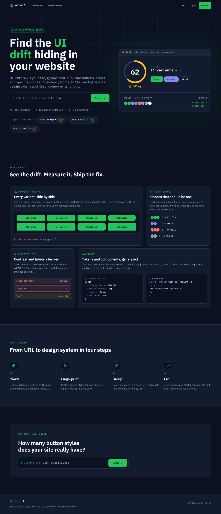
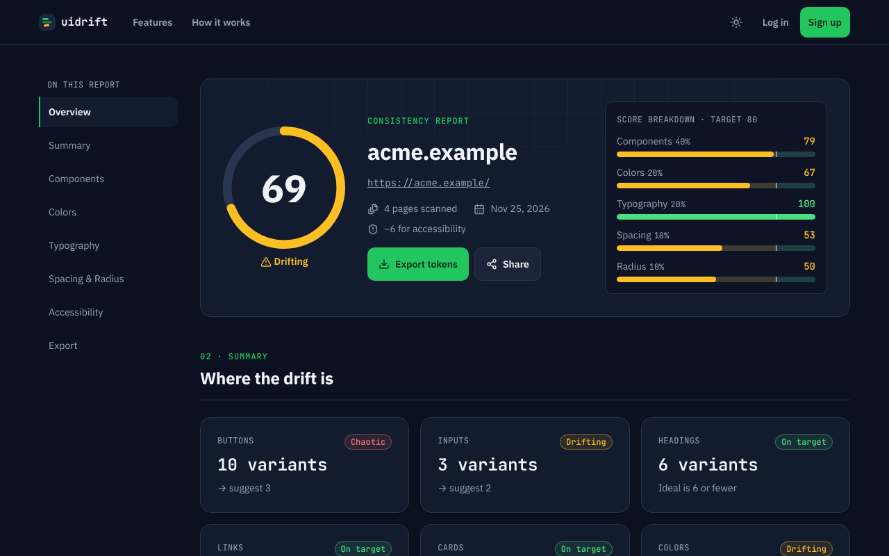
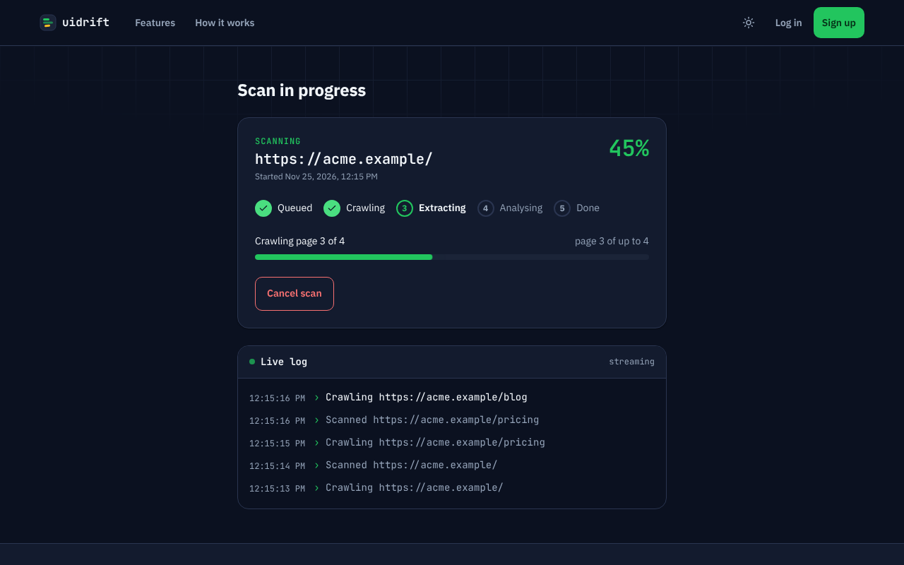
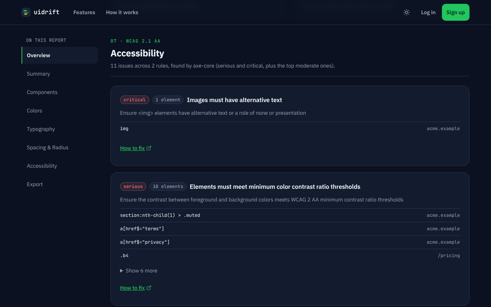
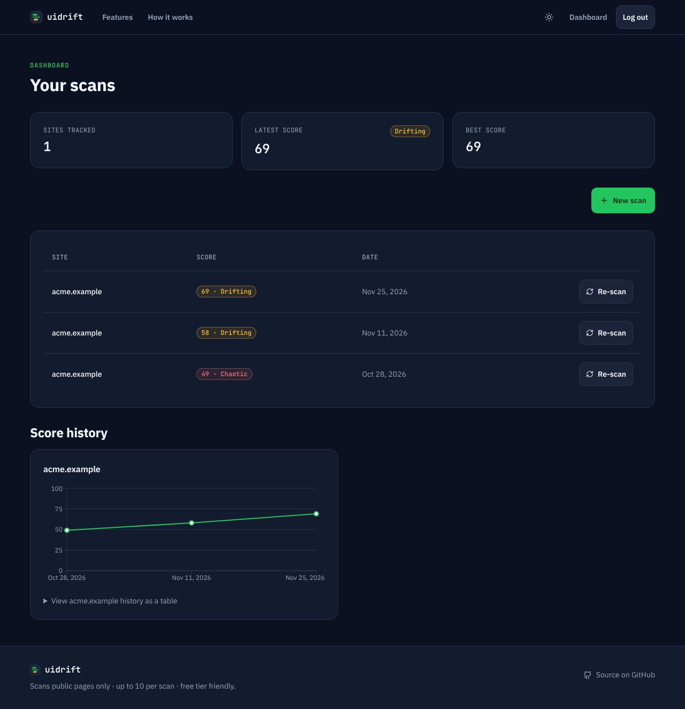
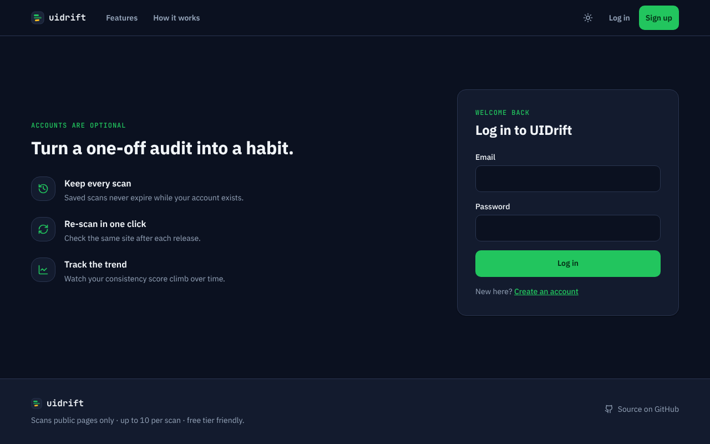
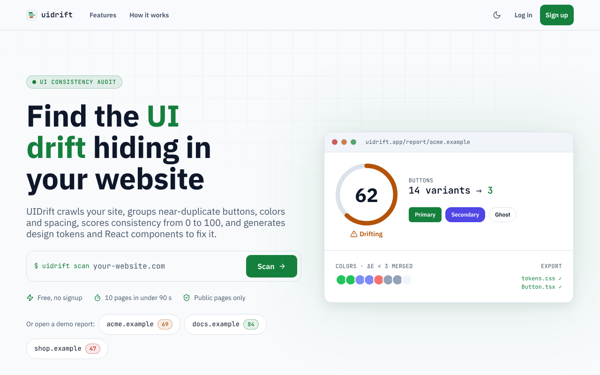
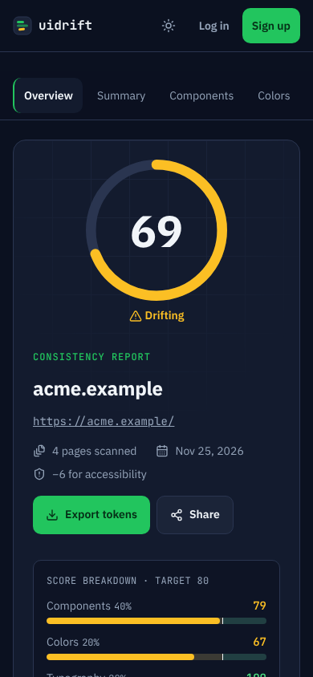

# UIDrift

**Find the UI drift hiding in your website.**

UIDrift scans a website, pulls out every button, input, heading, link and card along with its real computed styles, groups the near-duplicates and gives the site a **UI consistency score**. It then generates **design tokens** and **starter React components** from the most common patterns, so teams can move to a consistent design system.

[](docs/demo/uidrift-demo.mp4)

▶ **[Watch the demo video](docs/demo/uidrift-demo.mp4)** (90 s, 1080p · [WebM](docs/demo/uidrift-demo.webm)): landing → scan → live progress → full report → export → dashboard → light theme.

---

## Why

Large products are built by many teams. Over time they collect 15 kinds of buttons, dozens of near-identical colors and random spacing values. That "UI drift" makes products feel inconsistent and slows development. UIDrift makes the problem visible and measurable, and gives a starting point to fix it.

## Features

- 🔍 **Website crawler**: scans up to 10 same-domain pages with headless Chrome (Puppeteer), respects `robots.txt` and blocks images, fonts and media to save memory
- 🧬 **Style fingerprinting**: captures color, typography, spacing, radius, border and shadow of every component
- 🧩 **Smart grouping**: merges near-duplicate components (≤ 2 px) and colors (CIEDE2000 ΔE < 3)
- 📊 **Consistency score**: 0–100 per category and overall (PRD §9 formula), with an accessibility penalty of up to 10 points
- ♿ **Accessibility audit**: WCAG 2.1 A/AA checks via axe-core
- 🎨 **Token export**: `tokens.css` and `tokens.json`
- ⚛️ **Code generation**: starter React `Button`, `Input`, `Card` and `Heading` components (a test compiles them with strict TypeScript)
- ⚡ **Live progress**: Server-Sent Events backed by Redis pub/sub, with a polling fallback
- 📈 **History**: accounts, saved scans, re-scan and a score-over-time chart
- 🌗 Dark-first "Drift Console" UI with a light theme, keyboard navigation, reduced motion, WCAG 2.1 AA

| Landing                                  | Report                                 |
| ---------------------------------------- | -------------------------------------- |
|  |  |

| Live scan progress                 | Accessibility                                        | Dashboard                                    |
| ---------------------------------- | ---------------------------------------------------- | -------------------------------------------- |
|  |  |  |

| Login                                | Light theme                                        | Mobile                                        |
| ------------------------------------ | -------------------------------------------------- | --------------------------------------------- |
|  |  |  |

## Tech Stack

| Layer                    | Tech                                                                                                            |
| ------------------------ | --------------------------------------------------------------------------------------------------------------- |
| Frontend                 | Next.js 16 (App Router), React 19, TypeScript, Tailwind CSS (token-only theme), TanStack Query, Recharts, JSZip |
| Backend                  | Node.js, Express, TypeScript, Zod, Mongoose, pino                                                               |
| Queue / realtime / cache | Redis: BullMQ (scan queue), pub/sub (SSE fan-out), rate limiting, report cache, cancel flags                    |
| Crawler                  | Puppeteer, axe-core, culori (Delta-E)                                                                           |
| Database                 | MongoDB (Atlas M0)                                                                                              |
| Testing                  | Vitest, Supertest, React Testing Library, jest-axe                                                              |
| Tooling                  | npm workspaces, ESLint, Prettier, Husky + lint-staged, GitHub Actions, Docker                                   |

## How It Works

```
URL ─▶ SSRF guard ─▶ BullMQ job ─▶ Crawl pages (Puppeteer + axe) ─▶ Extract computed styles
    ─▶ Fingerprint ─▶ Group near-duplicates ─▶ Cluster colors ─▶ Score ─▶ Tokens + components
                       progress ─▶ Redis pub/sub ─▶ SSE ─▶ browser
```

1. You enter a public URL. It is validated, its DNS is resolved, and private/internal addresses are rejected.
2. A BullMQ worker (concurrency 1) crawls up to 10 pages, collecting component styles and accessibility issues. Every request the browser makes goes through the same guard.
3. The analysis engine fingerprints and groups components, clusters colors and scores consistency.
4. The report shows every variant with a live (sandboxed) preview and lets you export tokens and code.

## Getting Started

### Prerequisites

- Node.js 20+
- MongoDB (local or a free Atlas cluster)
- Redis 6+ (local, or a free Upstash database)

### Option A: Docker (everything included)

```bash
JWT_SECRET=$(openssl rand -hex 32) docker compose up --build
# open http://localhost:3000
```

### Option B: Local development

```bash
git clone https://github.com/mrahuls2608/UiDrift.git
cd UiDrift
npm install                     # installs all workspaces and builds @uidrift/shared

cp server/.env.example server/.env   # set MONGODB_URI, REDIS_URL, JWT_SECRET
cp web/.env.example web/.env.local   # API_URL=http://localhost:4000

npm run dev:api                 # http://localhost:4000 (runs the scan worker inline)
npm run dev:web                 # http://localhost:3000
```

Puppeteer downloads its own Chrome on install. To use a system Chrome instead, install with `PUPPETEER_SKIP_DOWNLOAD=1` and set `CHROME_PATH`.

Seed the demo reports shown on the landing page:

```bash
npm run seed:demos -- https://example.com https://another-site.com
```

### Run checks

```bash
npm run lint
npm run typecheck
npm test                                   # server + web unit/component tests
npm run test:coverage -w server            # with coverage thresholds (≥ 70%)

# integration tests (skipped unless configured)
TEST_REDIS_URL=redis://127.0.0.1:6379/1 CHROME_PATH=/path/to/chrome npm test -w server
```

## Recording the demo video

The video is recorded by a Playwright script against the production Next.js build and a demo API that
replays a genuine report (produced by the real crawler + analysis engine from a deliberately inconsistent
test site), so no MongoDB, Redis or network access is needed:

```bash
npm run build -w web
cp -r web/.next/static web/.next/standalone/web/.next/static
node scripts/demo/stub-api.mjs &                                          # demo API on :4000
API_URL=http://127.0.0.1:4000 node web/.next/standalone/web/server.js &   # app on :3000
node scripts/demo/record.mjs http://127.0.0.1:3000 docs/demo              # needs playwright + ffmpeg
```

Frames are captured over the Chrome DevTools screencast and encoded to H.264 MP4 and VP9 WebM with ffmpeg.

## Project Structure

```
UiDrift/
├── shared/   # @uidrift/shared: types, zod schemas, score constants
├── server/   # Express API, BullMQ worker, crawler, analysis engine, generators
├── web/      # Next.js app (UI kit in src/components/ui)
├── scripts/demo/  # demo video recorder + demo API
└── docs/     # PRD, DESIGN, RULES, TRD, PHASES, screenshots, demo video
```

## API (short)

| Method | Endpoint                                                 | Description                                  |
| ------ | -------------------------------------------------------- | -------------------------------------------- |
| POST   | `/api/v1/scans`                                          | Start a scan `{ url, maxPages }`             |
| GET    | `/api/v1/scans/:id`                                      | Scan status                                  |
| GET    | `/api/v1/scans/:id/events`                               | Live progress (SSE)                          |
| DELETE | `/api/v1/scans/:id`                                      | Cancel a running scan / delete an owned scan |
| GET    | `/api/v1/reports/:scanId`                                | Get report                                   |
| GET    | `/api/v1/reports/:scanId/export?format=css\|json\|react` | Export tokens / components                   |
| GET    | `/api/v1/demos`                                          | Demo reports                                 |
| POST   | `/api/v1/auth/signup` · `/login` · `/logout`             | Auth (httpOnly JWT cookie)                   |
| GET    | `/api/v1/me` · `/api/v1/me/scans`                        | Current user and saved scans                 |
| GET    | `/api/v1/health`                                         | Health (DB + Redis)                          |

Errors are always `{ "error": { "code", "message" } }`. Full details: [`docs/TRD.md`](docs/TRD.md).

## Security

- SSRF guard: only `http`/`https` on standard ports, no credentials, blocks localhost, `.local`/`.internal`, private, link-local, CGNAT, multicast and IPv4-mapped IPv6 ranges; DNS is resolved and **every** address re-checked, and every browser request is re-checked during the crawl (DNS-rebinding defence)
- Rate limits in Redis: 5 scans/hour/IP, 100 requests/15 min, 20 auth attempts/15 min
- `helmet`, CORS limited to the web origin, Origin check on state-changing requests (CSRF), 10 kb body limit
- bcrypt (10 rounds), HS256 JWT in an httpOnly, SameSite=Lax cookie; production refuses to start with a weak secret
- Captured styles are rendered only as allow-listed, validated inline style objects (never raw CSS/HTML); generated code only embeds validated values
- Page HTML is never stored, only extracted style data. Anonymous scans expire after 30 days (TTL index).

## Deployment (free tiers)

- **Web:** Vercel, root directory `web/`, env `API_URL=https://<your-api>`
- **API:** Render free web service using [`render.yaml`](render.yaml) (worker runs inline)
- **Redis:** Upstash or Render Key Value (free)
- **DB:** MongoDB Atlas M0

The free server sleeps after inactivity. The landing page pings `/health` on load and shows a "Waking up server…" state, and demo reports are cached in Redis.

## Limits

- Up to 10 pages per scan, one scan at a time
- Public pages only (no login-protected pages)
- 20 s per page, 90 s per scan, 300 elements per page

## Documentation

- [Product Requirements](docs/PRD.md)
- [Design](docs/DESIGN.md)
- [Technical Requirements](docs/TRD.md)
- [Project Rules](docs/RULES.md)
- [Build Phases](docs/PHASES.md)

## Roadmap

- Chrome extension for the current tab
- Side-by-side scan comparison
- Figma tokens export
- GitHub Action to block PRs that lower the score

## License

MIT
